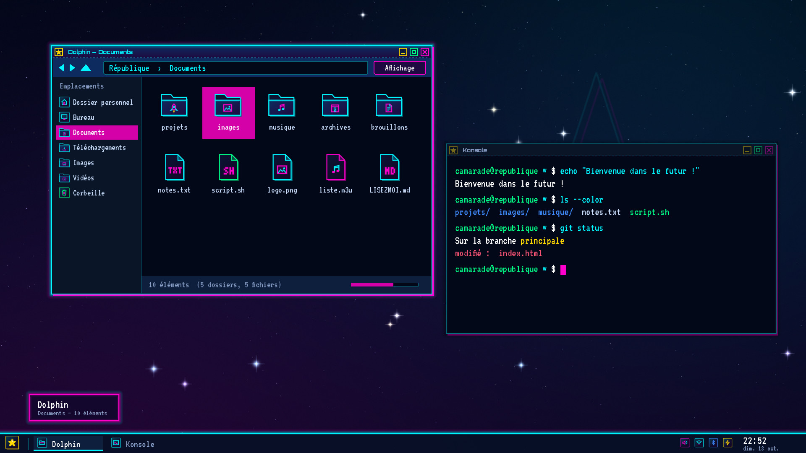
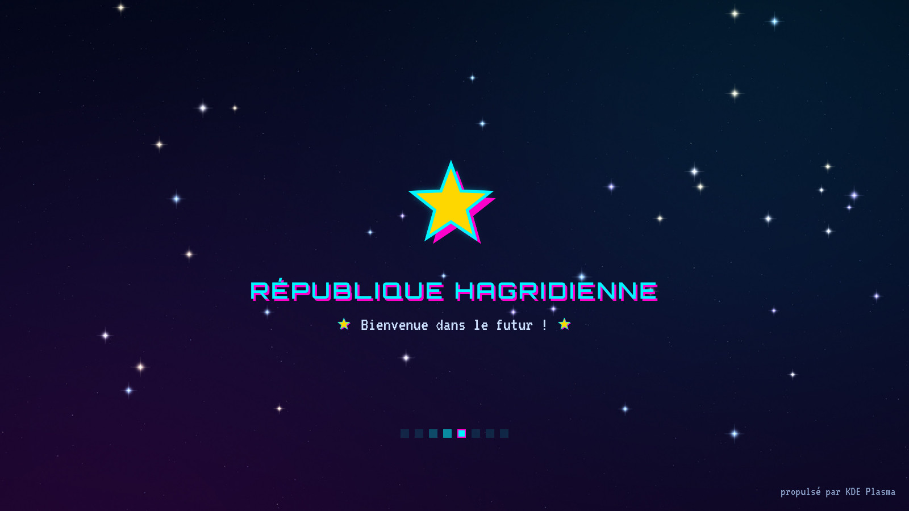
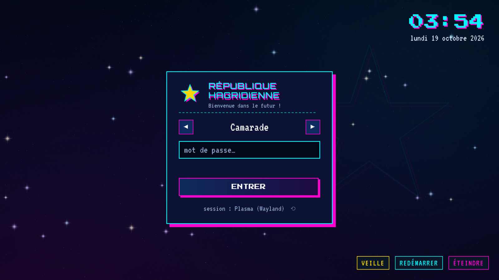
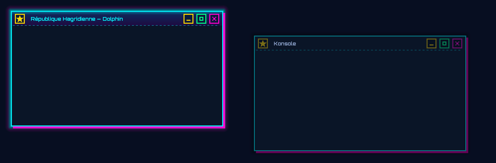
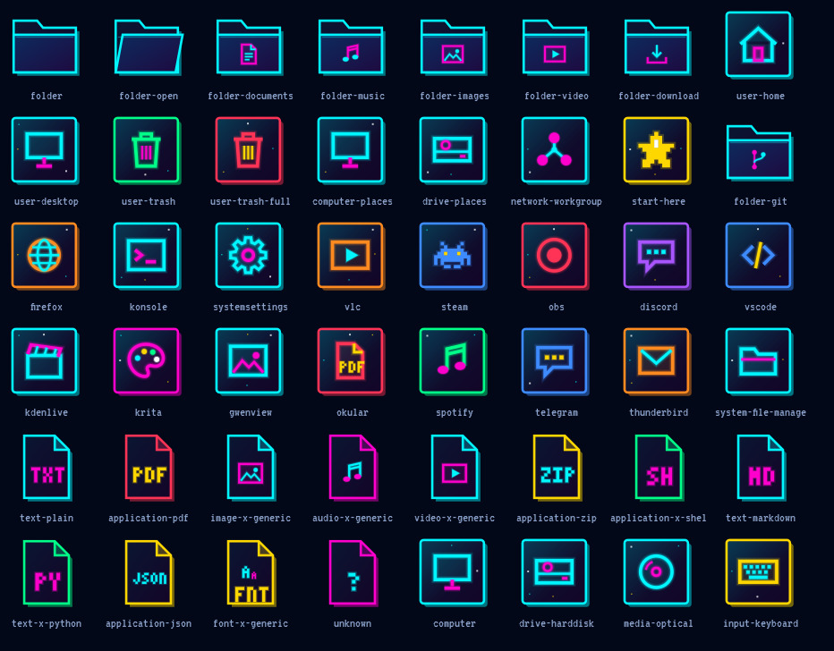
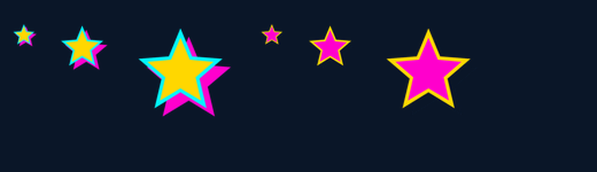

<h2 align="center">⬇️ English at the bottom ⬇️</h2>
<h1 align="center">⭐ République Hagridienne</h1>

<p align="center">
  <strong>Thème global KDE Plasma 6 néon rétro-futuriste</strong><br>
  couleurs · style Plasma · décorations de fenêtres · icônes · curseur · écrans de démarrage et de connexion
</p>

<p align="center">
  
  
  
</p>

<p align="center">
  
</p>

> [!NOTE]
> Les images de ce dépôt sont des **maquettes** assemblées avec les vrais fichiers du thème (cadres Plasma, décorations de fenêtres, icônes), pas des captures d'écran d'une session Plasma.

> [!IMPORTANT]
> **Licence propriétaire — tous droits réservés.** La reproduction et la distribution de ce thème sont interdites sans l'accord préalable de Soviet_Hagrid. Détails et exceptions dans [`LICENSE.md`](LICENSE.md).

Thème construit à partir du site de la République Hagridienne : fond nuit `#020818`, cyan `#00f5ff`, rose `#ff00cc`, or `#ffd700`, lime `#00ff88`, traits de 2 px, ombre rose dure décalée (comme les boutons du site), polices **VT323**, **Orbitron** et **Press Start 2P**, et l'étoile ⭐ partout. L'accroche du site — « Bienvenue dans le futur ! » — se retrouve sur l'écran de démarrage et l'écran de connexion.

## Aperçu

<table>
  <tr>
    <td align="center"><br><sub>Écran de démarrage</sub></td>
    <td align="center"><br><sub>Écran de connexion (SDDM)</sub></td>
  </tr>
  <tr>
    <td align="center"><br><sub>Décorations de fenêtres (active et inactive)</sub></td>
    <td align="center"><br><sub>Pack d'icônes « Hagridienne Néon »</sub></td>
  </tr>
  <tr>
    <td colspan="2" align="center"><br><sub>Curseur « Étoile Hagridienne » (facultatif)</sub></td>
  </tr>
</table>

## Contenu

| Composant | Dossier du dépôt | Installé dans |
|---|---|---|
| **Thème global** `com.republiquehagridienne.zephyr` — réglages par défaut et écran de démarrage animé | `share/plasma/look-and-feel/` | `~/.local/share/plasma/look-and-feel/` |
| **Schéma de couleurs** `RepubliqueHagridienne` | `share/color-schemes/` | `~/.local/share/color-schemes/` |
| **Style Plasma** `republique-hagridienne` — panneau, popups, info-bulles, widgets (variantes translucide, opaque, solide) | `share/plasma/desktoptheme/` | `~/.local/share/plasma/desktoptheme/` |
| **Décorations de fenêtres** (Aurorae) — barre de titre dégradée, trait néon, ombre rose dure, boutons pixel | `share/aurorae/themes/` | `~/.local/share/aurorae/themes/` |
| **Pack d'icônes** « Hagridienne Néon » — 733 icônes et environ 7 400 alias | `share/icons/hagridienne-neon/` | `~/.local/share/icons/` |
| **Curseur** « Étoile Hagridienne » *(facultatif)* | `share/icons/EtoileHagridienne/` | `~/.local/share/icons/` |
| **Fond d'écran** « Nuit hagridienne » — 7 résolutions dont 21:9 | `share/wallpapers/` | `~/.local/share/wallpapers/` |
| **Konsole** — jeu de couleurs et profil | `share/konsole/` | `~/.local/share/konsole/` |
| **Écran de connexion SDDM** *(facultatif)* | `share/sddm/themes/` | `/usr/share/sddm/themes/` |
| **Polices** VT323, Orbitron, Press Start 2P | `share/fonts/` | `~/.local/share/fonts/` |

Le style d'applications reste **Breeze** (couleurs reprises du schéma) et l'écran de verrouillage garde l'interface Breeze.

### Palette

| Rôle | Couleur |
|---|---|
| Zones de saisie, terminal | `#020818` |
| Fenêtres | `#0a1628` |
| Texte | `#cce0ff` |
| Cyan — traits, titres, liens, focus | `#00f5ff` |
| Rose — survol, ombre dure, accent | `#ff00cc` |
| Rose de sélection (texte blanc, contraste 4,8:1) | `#d400a8` |
| Or — étoile, bouton « réduire » | `#ffd700` |
| Lime — bouton « agrandir », succès | `#00ff88` |

## Prérequis

- **KDE Plasma 6**, avec **Breeze** (fourni avec Plasma) : les icônes absentes du pack retombent sur *Breeze Sombre*.
- `plasma-apply-lookandfeel` (fourni avec Plasma) pour l'option `--apply`.
- Pour l'écran de connexion *(facultatif)* : **SDDM** avec Qt 6.

## Installation

```bash
git clone https://github.com/SovietHagrid/Theme-Republique-Hagridienne-Y2K-pour-KDE-Plasma.git
cd republique-hagridienne-plasma

./install.sh --apply                  # copie tout dans ~/.local/share et applique le thème global
./install.sh --apply --star-cursor    # idem, avec le curseur étoile ⭐
```

Si `install.sh` n'est pas exécutable, lancer `bash install.sh --apply`.

Sans `--apply`, le script copie seulement les fichiers : choisir ensuite *Paramètres système → Apparence et style → Thème global → République Hagridienne*. Se déconnecter puis se reconnecter pour que les polices, le curseur et l'écran de démarrage soient pris en compte partout.

| Option | Effet |
|---|---|
| *(aucune)* | Copie les fichiers dans `~/.local/share`, sans rien appliquer. |
| `--apply` | Applique couleurs, style Plasma, décorations, icônes, polices (VT323 14 pt, titres en Orbitron), écran de démarrage et fond d'écran. |
| `--star-cursor` | Avec `--apply` : active le curseur ⭐. |
| `--sddm` | Installe l'écran de connexion dans `/usr/share/sddm/themes` (sudo), **sans l'activer**. |
| `--sddm-enable` | Active l'écran de connexion (à faire seulement après l'avoir testé). |

### Écran de connexion (SDDM) — en deux temps

Un thème SDDM défectueux peut donner un écran noir au démarrage : le tester d'abord, sans rien changer.

```bash
./install.sh --sddm       # copie le thème dans /usr/share/sddm/themes, sans l'activer
sddm-greeter-qt6 --test-mode --theme /usr/share/sddm/themes/republique-hagridienne
./install.sh --sddm-enable    # seulement si le test est concluant
```

Retour arrière : `sudo rm /etc/sddm.conf.d/10-republique-hagridienne.conf` (depuis un TTY, `Ctrl+Alt+F3`, en cas de souci).

## Réglages et personnalisation

- **Taille du texte** : VT323 est réglée à 14 pt (équivalent visuel du site). Elle est plus nette à 12 pt ou 24 pt (multiples de 16 px) : *Paramètres système → Apparence et style → Polices*.
- **Bordures des fenêtres** : le thème applique « Normal ». « Aucune bordure latérale » supprime le trait néon sur les côtés.
- **Boutons de la barre de titre** : la disposition n'est pas modifiée (*Décorations de fenêtres → Configurer les boutons*).
- **Écran de verrouillage** : choisir le fond « Nuit hagridienne » dans *Paramètres système → Verrouillage de l'écran → Apparence*.
- **Revenir aux icônes Breeze** : *Paramètres système → Apparence et style → Icônes → Breeze Sombre*.
- **Revenir à Breeze Sombre** : `plasma-apply-lookandfeel -a org.kde.breezedark`.

## Désinstallation

```bash
./uninstall.sh            # retire les fichiers de ~/.local/share
./uninstall.sh --sddm     # retire aussi l'écran de connexion (sudo)
```

Si le thème est appliqué, appliquer d'abord un autre thème global (voir ci-dessus). Les polices restent dans `~/.local/share/fonts/republique-hagridienne` : supprimer ce dossier pour les retirer.

## Comment c'est fait

- **Style Plasma** : cadres au format `FrameSvg` de Plasma (toile de 157×64 : 9 tranches, masque de flou, ombre), avec les mêmes noms d'éléments que Breeze et un dessin entièrement original — trait néon de 2 px, lueur cyan et rose.
- **Décorations de fenêtres** : thème Aurorae en SVG, compatible avec le nouveau moteur (v2) et l'ancien (v1) ; `install.sh` détecte celui qui est présent et règle `library=` en conséquence. La marge de 12 px autour de la fenêtre sert d'ombre : lueur cyan et décalage rose de 4 px.
- **Icônes** : SVG simples (dégradés linéaires uniquement), `Inherits=breeze-dark,breeze,hicolor` pour tout ce que le pack ne couvre pas.
- **Écrans de démarrage et de connexion** : QML pur (QtQuick), sans dépendance à un style de contrôles.

## État de la version

Version 1.1, validée hors session : fichiers (JSON, INI, XML — dont les 733 SVG des icônes, sans alias cassé), rendu des SVG avec un simulateur de `FrameSvg`, QML du splash et de SDDM exécuté dans Qt 6.12 avec des objets SDDM simulés, scripts passés à `shellcheck` et testés dans un `HOME` temporaire. Le thème a été écrit d'après les sources de KDE de mi-octobre 2026.

**Pas encore éprouvée dans une vraie session Plasma** : un réglage fin peut être nécessaire au premier essai. Pour signaler un problème, joindre la version de Plasma (`plasmashell --version`) et la sortie de `./install.sh`.

## Historique

- **1.1** — pack d'icônes « Hagridienne Néon » intégré (icônes par défaut du thème global) ; licence propriétaire.
- **1.0** — première version : couleurs, style Plasma, décorations de fenêtres, écran de démarrage, écran de connexion, fond d'écran, curseur, Konsole, polices.

## Licence

© 2026 Soviet_Hagrid — **tous droits réservés**. La reproduction et la distribution de ce thème, du pack d'icônes « Hagridienne Néon » et des scripts sont interdites sans l'accord préalable de Soviet_Hagrid. L'installation et l'usage privé d'un exemplaire reçu de l'auteur ou avec son accord restent permis. Texte complet : [`LICENSE.md`](LICENSE.md).

Pour une demande d'autorisation, contacter Soviet_Hagrid via [soviet@republiquehagridienne.com](mailto:soviet@republiquehagridienne.com?subject=Demande%20d'autorisation%20de%20license%20de%20RSH%20Plasma).

## Crédits

- Polices **VT323**, **Orbitron** et **Press Start 2P**, sous [licence SIL OFL 1.1](https://openfontlicense.org/) (textes dans `share/fonts/republique-hagridienne/`) : © The VT323 Project Authors, © The Orbitron Project Authors, © The Press Start 2P Project Authors.
- **Breeze**, **KDE Plasma** et **SDDM** ne sont pas inclus et appartiennent à leurs auteurs. KDE et Plasma sont des marques de KDE e.V. ; ce projet est indépendant et n'est pas affilié à KDE.
- Les marques, noms et logos de tiers stylisés dans les icônes d'applications (Firefox, Steam, Discord, etc.) restent la propriété de leurs titulaires.


<h1 align="center">⭐ République Hagridienne</h1>

<p align="center">
  <strong>Global KDE Plasma 6 retro-futuristic neon theme</strong><br>
  colors · Plasma style · window decorations · icons · cursor · boot and login screens
</p>

<p align="center">
  
  
  
</p>

<p align="center">
  
</p>

> [!NOTE]
> The images in this repository are **mockups** assembled from the real theme files (Plasma frames, window decorations, icons), not screenshots of a Plasma session.

> [!IMPORTANT]
> **Proprietary license — all rights reserved.** Reproduction and distribution of this theme are prohibited without the prior consent of Soviet_Hagrid. Details and exceptions in [`LICENSE.md`](LICENSE.md).

Theme built from the République Hagridienne website: night background `#020818`, cyan `#00f5ff`, pink `#ff00cc`, gold `#ffd700`, lime `#00ff88`, 2 px strokes, hard offset pink shadow (like the site's buttons), fonts **VT323**, **Orbitron** and **Press Start 2P**, and the star ⭐ everywhere. The site's tagline — "Welcome to the future!" — appears on the boot screen and the login screen.

## Preview

<table>
  <tr>
    <td align="center"><br><sub>Boot screen</sub></td>
    <td align="center"><br><sub>Login screen (SDDM)</sub></td>
  </tr>
  <tr>
    <td align="center"><br><sub>Window decorations (active and inactive)</sub></td>
    <td align="center"><br><sub>Hagridienne Néon icon pack</sub></td>
  </tr>
  <tr>
    <td colspan="2" align="center"><br><sub>Etoile Hagridienne cursor (optional)</sub></td>
  </tr>
</table>

## Contents

| Component | Repository folder | Installed to |
|---|---|---|
| **Global theme** `com.republiquehagridienne.zephyr` — default settings and animated boot screen | `share/plasma/look-and-feel/` | `~/.local/share/plasma/look-and-feel/` |
| **Color scheme** `RepubliqueHagridienne` | `share/color-schemes/` | `~/.local/share/color-schemes/` |
| **Plasma style** `republique-hagridienne` — panel, popups, tooltips, widgets (translucent, opaque, solid variants) | `share/plasma/desktoptheme/` | `~/.local/share/plasma/desktoptheme/` |
| **Window decorations** (Aurorae) — gradient title bar, neon stroke, hard pink shadow, pixel buttons | `share/aurorae/themes/` | `~/.local/share/aurorae/themes/` |
| **Icon pack** Hagridienne Néon — 733 icons and roughly 7,400 aliases | `share/icons/hagridienne-neon/` | `~/.local/share/icons/` |
| **Cursor** Etoile Hagridienne *(optional)* | `share/icons/EtoileHagridienne/` | `~/.local/share/icons/` |
| **Wallpaper** Nuit hagridienne — 7 resolutions including 21:9 | `share/wallpapers/` | `~/.local/share/wallpapers/` |
| **Konsole** — color scheme and profile | `share/konsole/` | `~/.local/share/konsole/` |
| **SDDM login screen** *(optional)* | `share/sddm/themes/` | `/usr/share/sddm/themes/` |
| **Fonts** VT323, Orbitron, Press Start 2P | `share/fonts/` | `~/.local/share/fonts/` |

Application style remains **Breeze** (colors taken from the scheme) and the lock screen keeps the Breeze interface.

### Palette

| Role | Color |
|---|---|
| Input fields, terminal | `#020818` |
| Windows | `#0a1628` |
| Text | `#cce0ff` |
| Cyan — strokes, titles, links, focus | `#00f5ff` |
| Pink — hover, hard shadow, accent | `#ff00cc` |
| Selection pink (white text, 4.8:1 contrast) | `#d400a8` |
| Gold — star, "minimize" button | `#ffd700` |
| Lime — "maximize" button, success | `#00ff88` |

## Requirements

- **KDE Plasma 6**, with **Breeze** (shipped with Plasma): icons missing from the pack fall back to *Breeze Dark*.
- `plasma-apply-lookandfeel` (shipped with Plasma) for the `--apply` option.
- For the login screen *(optional)*: **SDDM** with Qt 6.

## Installation

```bash
git clone https://github.com/SovietHagrid/Theme-Republique-Hagridienne-Y2K-pour-KDE-Plasma.git
cd republique-hagridienne-plasma

./install.sh --apply                  # copies everything into ~/.local/share and applies the global theme
./install.sh --apply --star-cursor    # same, with the ⭐ star cursor
```

If `install.sh` is not executable, run `bash install.sh --apply`.

Without `--apply`, the script only copies the files: then choose *System Settings → Appearance and Style → Global Theme → République Hagridienne*. Log out and back in so that fonts, cursor and boot screen take effect everywhere.

| Option | Effect |
|---|---|
| *(none)* | Copies the files into `~/.local/share`, without applying anything. |
| `--apply` | Applies colors, Plasma style, decorations, icons, fonts (VT323 14 pt, titles in Orbitron), boot screen and wallpaper. |
| `--star-cursor` | With `--apply`: enables the ⭐ cursor. |
| `--sddm` | Installs the login screen into `/usr/share/sddm/themes` (sudo), **without enabling it**. |
| `--sddm-enable` | Enables the login screen (only do this after testing it). |

### Login screen (SDDM) — in two steps

A broken SDDM theme can leave you with a black screen at boot: test it first, without changing anything.

```bash
./install.sh --sddm       # copies the theme into /usr/share/sddm/themes, without enabling it
sddm-greeter-qt6 --test-mode --theme /usr/share/sddm/themes/republique-hagridienne
./install.sh --sddm-enable    # only if the test succeeds
```

Rollback: `sudo rm /etc/sddm.conf.d/10-republique-hagridienne.conf` (from a TTY, `Ctrl+Alt+F3`, if something goes wrong).

## Settings and customization

- **Text size**: VT323 is set to 14 pt (the visual equivalent of the site). It looks sharper at 12 pt or 24 pt (multiples of 16 px): *System Settings → Appearance and Style → Fonts*.
- **Window borders**: the theme applies "Normal". "No side borders" removes the neon stroke on the sides.
- **Title bar buttons**: the layout is not modified (*Window Decorations → Configure Buttons*).
- **Lock screen**: pick the Nuit hagridienne background in *System Settings → Screen Locking → Appearance*.
- **Back to Breeze icons**: *System Settings → Appearance and Style → Icons → Breeze Dark*.
- **Back to Breeze Dark**: `plasma-apply-lookandfeel -a org.kde.breezedark`.

## Uninstallation

```bash
./uninstall.sh            # removes the files from ~/.local/share
./uninstall.sh --sddm     # also removes the login screen (sudo)
```

If the theme is applied, first apply another global theme (see above). The fonts stay in `~/.local/share/fonts/republique-hagridienne`: delete that folder to remove them.

## How it's made

- **Plasma style**: frames in Plasma's `FrameSvg` format (157×64 canvas: 9 slices, blur mask, shadow), using the same element names as Breeze with entirely original artwork — 2 px neon stroke, cyan and pink glow.
- **Window decorations**: Aurorae theme in SVG, compatible with both the new engine (v2) and the old one (v1); `install.sh` detects which is present and sets `library=` accordingly. The 12 px margin around the window acts as the shadow: cyan glow and a 4 px pink offset.
- **Icons**: plain SVG (linear gradients only), `Inherits=breeze-dark,breeze,hicolor` for everything the pack doesn't cover.
- **Boot and login screens**: pure QML (QtQuick), with no dependency on a control style.

## Version status

Version 1.1, validated outside a session: files (JSON, INI, XML — including the 733 icon SVGs, with no broken aliases), SVG rendering with a `FrameSvg` simulator, the splash and SDDM QML executed in Qt 6.12 with simulated SDDM objects, scripts run through `shellcheck` and tested in a temporary `HOME`. The theme was written from KDE sources as of mid-October 2026.

**Not yet tried in a real Plasma session**: some fine-tuning may be needed on first run. To report a problem, include your Plasma version (`plasmashell --version`) and the output of `./install.sh`.

## Changelog

- **1.1** — Hagridienne Néon icon pack integrated (the global theme's default icons); proprietary license.
- **1.0** — first release: colors, Plasma style, window decorations, boot screen, login screen, wallpaper, cursor, Konsole, fonts.

## License

© 2026 Soviet_Hagrid — **all rights reserved**. Reproduction and distribution of this theme, the Hagridienne Néon icon pack and the scripts are prohibited without the prior consent of Soviet_Hagrid. Installing and privately using a copy received from the author or with their consent remains permitted. Full text: [`LICENSE.md`](LICENSE.md).

To request permission, contact Soviet_Hagrid at [soviet@republiquehagridienne.com](mailto:soviet@republiquehagridienne.com?subject=Permission%20request%20for%20the%20RSH%20Plasma%20theme%20license).

## Credits

- Fonts **VT323**, **Orbitron** and **Press Start 2P**, under the [SIL OFL 1.1 license](https://openfontlicense.org/) (texts in `share/fonts/republique-hagridienne/`): © The VT323 Project Authors, © The Orbitron Project Authors, © The Press Start 2P Project Authors.
- **Breeze**, **KDE Plasma** and **SDDM** are not included and belong to their authors. KDE and Plasma are trademarks of KDE e.V.; this project is independent and is not affiliated with KDE.
- Third-party trademarks, names and logos stylized in the application icons (Firefox, Steam, Discord, etc.) remain the property of their respective owners.
